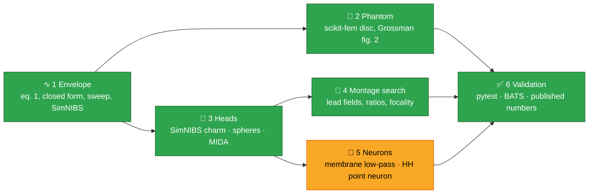

<div align="center">

# ⚡〰️🧠 ti-sim

### Temporal interference stimulation, simulated end to end

*Two kHz currents, a beat frequency the brain can follow, and a focus that can be deep.*
*Is that true at human scale, and by how much? Open solvers, open data, published numbers.*

[](#-where-things-stand)
[](LICENSE)
[](docs/running.md)
[](docs/research/02-replication-targets.md)
[](pyproject.toml)
[](https://copr.fedorainfracloud.org/coprs/mhough/neurofedora/)

[**Research notes**](docs/research/README.md) ·
[**Running it**](docs/running.md) ·
[**MIDA on the DGX Spark (handoff)**](docs/handoff-dgx-spark.md) ·
[**Roadmap**](docs/research/05-roadmap.md) ·
[**References**](docs/research/references.md)

</div>

---

## 🧪 The idea

Grossman et al. (Cell, 1 June 2017) drive two electrode pairs at f and f + Δf in the kHz
range. Where the two fields **E₁** and **E₂** are equal and parallel the sum is a carrier
fully modulated at Δf; elsewhere it is barely modulated. Along a direction **n** the
modulation amplitude is

$$E_{AM}(\mathbf n) = \big|\,|(\mathbf E_1+\mathbf E_2)\cdot\mathbf n| - |(\mathbf E_1-\mathbf E_2)\cdot\mathbf n|\,\big|$$

and because the fields are quasi-static, the whole thing is **one Laplace solve per pair
plus geometry**. That makes every published TI simulation reproducible with open tools,
and this repository does that: Grossman's saline phantom with scikit-fem, heads with
SimNIBS (charm models, layered spheres and the MIDA model through SimNIBS's
`create_mesh`), montage search on lead fields, and the membrane arithmetic that says what
a neuron can and cannot do with a kHz carrier.



<sub>🟩 implemented · 🟨 partial. A NEURON readout and the MIDA run with real data are the open blocks.</sub>

---

## 📚 The research so far

The notes under [`docs/research/`](docs/research/README.md) are the substance; the short version:

### 📜 1. The literature, 2017-2026 → [note 01](docs/research/01-literature.md)

162 PubMed hits read by title, the modelling papers by abstract, four by full text. The
physics is settled; the human numbers are small (**0.2-0.4 V/m** envelopes at 2 mA,
comparable to tACS in the target but far more focal); the **mechanism is open**
(Mirzakhalili 2020: a passive membrane cannot demodulate; Esmaeilpour 2021: ~80 V/m
needed with a 2 kHz carrier in slices; Budde 2023 and Jabban 2025: peripheral thresholds
ignore modulation depth). The two human validations (Violante 2023 hippocampus, Wessel
2023 striatum) were modelled in Sim4Life on **MIDA**, which is why a King's College
colleague is simulating on it: Inês Violante's group is now at KCL.

### 🧫 2. Grossman's phantom, replicated → [note 02](docs/research/02-replication-targets.md)

| layout | paper peak position (x, y)/R · HWHM | ours |
|---|---|---|
| C (1:1) | (0, 0) · (0.42, 0.49) | (0, 0.00) · (0.42, 0.50) |
| D (1:2.5) | (-0.2, 0) · (0.38, 0.40) | (-0.23, 0.01) · (0.42, 0.39) |
| E (1:4) | (-0.35, 0) · (0.37, 0.34) | (-0.34, -0.01) · (0.43, 0.34) |

Every position and half-width in the paper's table is reproduced. The amplitudes come out
a constant **~7× above the paper's simulated values** with the stated 0.333 S/m, 10 mm
and 1 mA: a definition or a saline conductivity we cannot see; the pipeline asserts the
geometry and records the ratio instead of hiding it.

### 🧠 3. Heads: ernie now, MIDA when you have it → [note 04](docs/research/04-mida.md)

`examples/ernie_ti.py` runs SimNIBS's TI montage and Wessel 2023's striatal montage on
the SimNIBS example head with ROI statistics at MNI targets and TI-vs-tACS focality.
`ti_sim.mida` maps all **115 MIDA structures** to SimNIBS tissues (deep nuclei kept as
ROIs) and meshes the model with `create_mesh`; the same route is exercised on a 4-layer
sphere. MIDA's licence forbids redistribution, so you bring your own copy
(`scripts/check-mida.sh`). All head fields are normalised to the exact current of the
discrete solution, not SimNIBS's flux estimate, which we found 5-13 % off on 2 mm pads
([note 02 §2](docs/research/02-replication-targets.md)); the lead field is unaffected.

### 🔁 4. What SimNIBS gives us → [note 03](docs/research/03-simnibs-reuse.md)

Charm heads, the FEM, `TI_utils` (the same equation, cross-checked to 1e-12), lead
fields, `create_mesh`, MNI mapping and the flexible electrode optimiser with
`e_postproc="max_TI"`. Reused, not copied. TI-Toolbox (GPL-3, 2026) is the end-user
application on Docker; this is the scriptable, Fedora-native, phantom-to-MIDA layer.

---

## 📊 Where things stand

| | |
|---|---|
| 🧩 blocks | 5 of 6 implemented, 1 partial |
| ✅ tests | 30 pytest tests (phantom FEM vs analytic field, envelope vs SimNIBS, MIDA mapping of all 115 structures, montage search, sphere mesh route, ernie head) + a BATS pipeline with machine-checked numbers |
| 🖥️ hosts | Fedora 44 with `python3-simnibs` from the COPR; container recipe for anywhere else |
| 📦 stack | `python3-simnibs 4.6.0`, scikit-fem, numpy/scipy via `uv` |
| 📝 next | MIDA with real data (Wessel's montage first) · electrode positions on MIDA · lead-field search on ernie · NEURON readout · mesh/placement sensitivity |

Full list: [docs/research/05-roadmap.md](docs/research/05-roadmap.md).

---

## 📦 Data

| resource | what | licence | how |
|---|---|---|---|
| [SimNIBS `ernie`](https://github.com/simnibs/example-dataset) | low-res charm head | CC BY-NC 4.0 | `scripts/fetch-ernie.sh` (sha256 pinned); never packaged |
| [MIDA v1.0](https://itis.swiss/virtual-population/regional-human-models/mida-model/) | 0.5 mm head, 115 structures (IT'IS / FDA) | IT'IS licence: free, **no redistribution**, cite Iacono 2015 | register on the IT'IS page, then `scripts/check-mida.sh`, `export TI_SIM_MIDA=...` |
| Grossman 2017 phantom | no data deposit; the figure 2 table is in `examples/grossman_phantom.py` | journal | replicated |

## 🚀 Quick start

```sh
sudo dnf install python3-simnibs simnibs-data bats                 # mhough/neurofedora COPR
uv venv --system-site-packages --python /usr/bin/python3 && uv sync
uv run pytest -q -m "not slow"                                       # ~10 s
TI_SIM_OUT=results/grossman_phantom.json uv run examples/grossman_phantom.py   # 10 s
TI_SIM_FETCH=1 scripts/run-pipeline.sh                               # everything, ~6 min on 4 cores
```

Environment variables, the container and the optional stages are in
[docs/running.md](docs/running.md).

## 🗂️ Layout

```
src/ti_sim/      envelope · phantom · head · electrodes · labelvol · mida · montage · membrane · hh · tissues · report
examples/        grossman_phantom · layered_sphere · ernie_ti · ernie_montage_search · ernie_flex_ti · ernie_placement_sensitivity · mida_ti
tests/           pytest units + pipeline.bats (numbers asserted against the papers)
scripts/         run-pipeline · fetch-ernie · check-mida · container-run
docs/research/   the research notes summarised above
Containerfile    fedora:44 + COPR SimNIBS + uv venv
```

## 📜 Licence

Apache-2.0 (see [LICENSE](LICENSE)). SimNIBS (GPL-3) is imported, not vendored. MIDA and
ernie keep their own licences and are never redistributed here.

## 🙏 Acknowledgements

Built on [SimNIBS](https://simnibs.github.io/simnibs/) and [scikit-fem](https://github.com/kinnala/scikit-fem),
on the published work of the Boyden/Grossman, Brooks, Parra/Bikson, Lempka, Hummel and
Violante groups, and on the MIDA model of the IT'IS Foundation and the US FDA. Packaged
for Fedora through [NeuroFedora](https://neuro.fedoraproject.org/).

<div align="center">
<sub>Morgan Hough · prototype · developed with Claude Code</sub>
</div>
